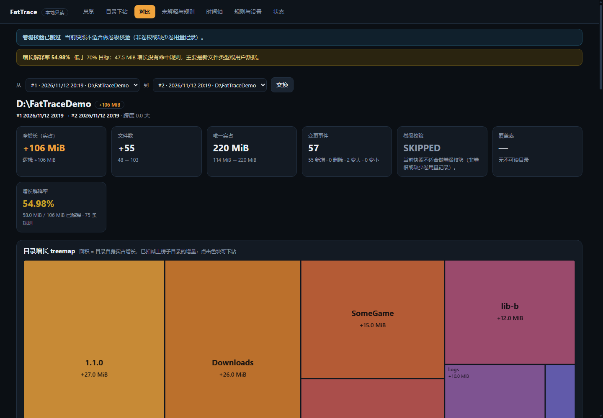
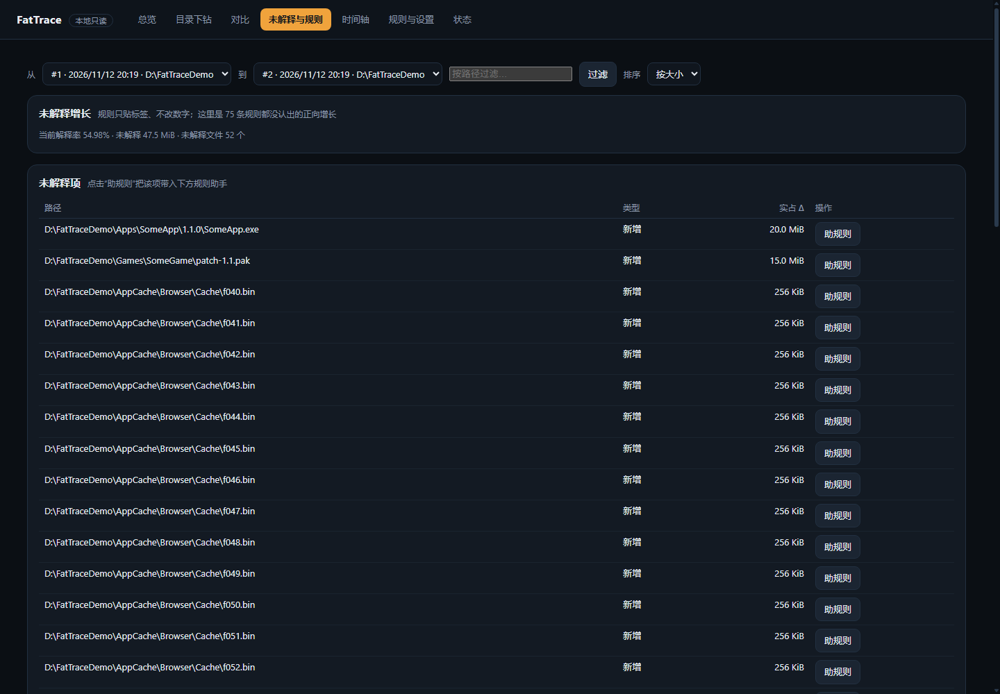
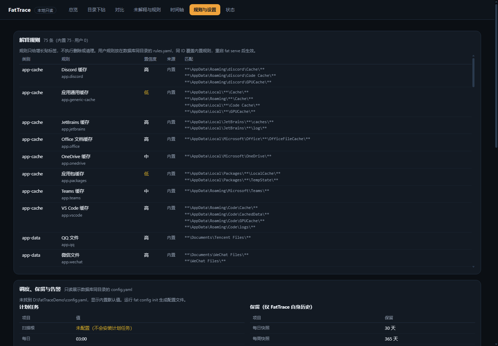
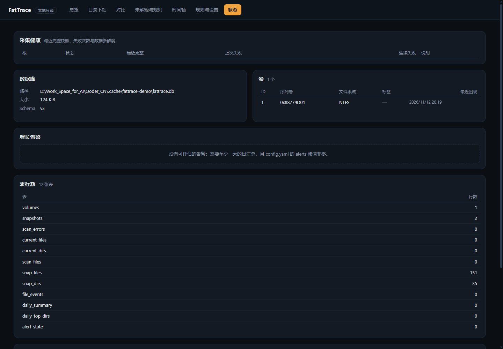

<p align="center">
  
</p>

<h1 align="center">FatTrace</h1>

<p align="center">
  <a href="https://github.com/Xeayy/FatTrace/actions/workflows/ci.yml"></a>
  <a href="LICENSE"></a>
  <a href="https://github.com/Xeayy/FatTrace/releases/latest"></a>
</p>

<p align="center">
  A local-first disk-growth tracker for Windows: take a snapshot every day, diff every week, and answer three questions — <b>what is growing, by how much, and what is it likely to be</b>.<br>
  It only observes and explains. It <b>never deletes, moves or cleans</b> your files.
</p>

---

## What it does

- **Daily snapshots + weekly full diff**: aligns files and directories by NTFS FileID and classifies additions, growth, shrinkage, deletions and moves/renames, with directory-level attribution.
- **Rule-based explanation**: 75 built-in rules group growth into caches, logs, app updates, game installs, dev artifacts and more; extend them with a user `rules.yaml`.
- **Several ways to look**: single-file offline HTML reports, a read-only local web UI (treemap / drill-down / compare / timeline), a system tray icon and a CLI.
- **Unexplained-growth browser + rule assistant**: browse growth that no rule recognised, preview candidate rule hits, and generate a `rules.yaml` draft (it only takes effect after you confirm).
- **Collection health alerts**: failed scans, repeated failures and stale data are surfaced consistently in `doctor`, the tray and the web UI.
- **Unattended operation**: Windows Task Scheduler runs the daily/weekly collection, catches up after missed runs and can be restricted to AC power.

## Screenshots

| Compare & treemap | Unexplained-growth browser |
|---|---|
|  |  |

| Rules & settings | Status & health |
|---|---|
|  |  |

> Screenshots use neutral demo data (`D:\FatTraceDemo`), not real user files.

## Quick start

### Option A: installer (recommended)

1. Download `FatTrace-Setup-<version>-windows-amd64.exe` from [Releases](https://github.com/Xeayy/FatTrace/releases/latest) (use `-arm64` on ARM64 devices).
2. Run the installer (it supports a custom install path, installs per-user by default without administrator rights, and creates desktop and Start Menu shortcuts).
3. Tick "Run FatTrace" at the end, or double-click the **FatTrace** desktop icon: it starts in the system tray with no console flash and opens the local read-only dashboard in your default browser.

### Option B: portable

1. Download `fat-<version>-windows-amd64.exe` and `fatgui-<version>-windows-amd64.exe` from [Releases](https://github.com/Xeayy/FatTrace/releases/latest) and **put them in the same folder** (you may rename them to `fat.exe` / `fatgui.exe`).
2. Double-click `fatgui.exe`: no console flash, starts the tray and opens the local dashboard.
3. On first use run `fat.exe setup -roots "D:\"` to configure scan roots (the dashboard shows "not configured"; the UI itself is read-only). You can also install the scheduled tasks for automatic collection.

Equivalent CLI flow:

```powershell
.\fat.exe setup -roots "D:\"     # create database/config, check scheduled tasks
.\fat.exe maintain --kind daily  # one snapshot + daily summary + alerts
.\fat.exe tray                   # tray + read-only web UI (or double-click fatgui.exe / FatTrace.exe)
.\fat.exe report --week          # generate a single-file HTML weekly report
```

### Option C: install from source with Go

```powershell
go install github.com/Xeayy/FatTrace/cmd/fat@latest
```

This builds the `fat` CLI only (the GUI launcher needs the `-H windowsgui` linker flag; use the installer or the portable build instead). The binary lands in `%USERPROFILE%\go\bin\fat.exe`; make sure that directory is on `PATH`. `fat --version` reports the module version.

### Verify the download (optional)

```powershell
Get-Content .\SHA256SUMS.txt | ForEach-Object {
  $hash, $name = $_ -split '  ', 2
  if ((Get-FileHash $name -Algorithm SHA256).Hash -ieq $hash) { "OK  $name" } else { "BAD $name" }
}
```

> No code signing: until a commercial certificate is purchased, the first run may trigger SmartScreen. Choose "More info" → "Run anyway". Administrator rights are not required.

## Privacy and security

- **Fully local**: listens on `127.0.0.1` with a random port and a per-session token only; no network requests, no telemetry, no cloud sync.
- **Read-only**: the web UI and reports expose no write or delete endpoints. Cleanup only ever touches FatTrace's own history database (`fat prune`) and **never the files being scanned**.
- The database, reports and logs contain **full file paths and sizes** and are local sensitive data; review them before sharing. See [SECURITY.md](SECURITY.md).

## Known limitations

- Local **NTFS** only (Windows 10/11); junctions/symlinks and network paths are skipped.
- A standard user cannot read protected directories (such as `System Volume Information`); coverage is typically ~99%. Volume-level gaps are attributed between "invisible system area" and "file statistics missing".
- Not real-time monitoring; it provides growth clues on a schedule.
- No automatic cleanup; it is not an antivirus or ransomware-protection tool.

## How it works

1. **Snapshot**: `NtQueryDirectoryFile` + FileID enumerate metadata (path/size/allocated size/timestamps), deduplicate hard links and skip junctions; write to SQLite (WAL).
2. **Diff**: align two snapshots by FileID, classify added/grown/shrunk/deleted/moved/renamed, and do move-adjusted directory attribution.
3. **Explain**: the rule engine tags positive growth with a category and computes an explanation rate; unexplained items can be browsed and turned into rules semi-automatically.
4. **Validate**: cross-check the root Δ against the volume-used Δ; attribute the residual between "invisible system area" and "file statistics missing".
5. **Present**: CLI / single-file HTML report / read-only local web UI / tray, all from the same data.

Components and data flow: [docs/architecture.md](docs/architecture.md).

## Commands

| Command | Purpose |
|---|---|
| `fat setup` | First-time setup: database/config/scheduled tasks |
| `fat snap <root>` | Take one snapshot |
| `fat maintain --kind daily\|weekly` | Snapshot + daily summary + alerts + (weekly report/prune) |
| `fat diff [--from A --to B]` | Compare two snapshots |
| `fat report [--week]` | Generate a single-file HTML report |
| `fat serve [--open]` / `fat tray` / `fatgui.exe` | Read-only web UI / tray / no-flash launcher |
| `fat daily` / `fat alerts` | Daily summary / growth alerts |
| `fat prune [--apply]` | Prune FatTrace's own expired history (dry-run by default) |
| `fat schedule install\|status\|uninstall` | Scheduled-task management |
| `fat doctor` / `fat status` | Self-check / overview |

Full flags: `fat help`.

## Troubleshooting and FAQ

- **SmartScreen blocks the first run**: no code signature; choose "Run anyway", or sign the binary yourself.
- **diff/report says there is nothing to compare**: only one snapshot exists; wait for a second collection.
- **Coverage < 100%**: a standard user cannot read protected directories; this is expected. Check the error count and the volume-level attribution.
- **Volume check WARN**: look at "unexplained part of the gap"; near zero means the gap comes from invisible system areas and usually needs no investigation.
- **Report says file rows pruned**: file-level detail was pruned by the retention policy; directory aggregates remain browsable.
- **Changed rules.yaml has no effect**: rules load at process start; restart `serve`/`tray`.
- **Want demo/screenshot data**: `python scripts/demo_data.py init` → snapshot → `grow` → snapshot again (neutral data, see [scripts/demo_data.py](scripts/demo_data.py)).
- More: `fat doctor` prints actionable hints; the documentation index is [docs/README.md](docs/README.md).

## Configuration

Configuration lives in `config.yaml` next to the database (created by `fat config init`); user rules are in [examples/rules.yaml](examples/rules.yaml). Common keys:

| Key | Meaning |
|---|---|
| `schedule.roots` | Scan root list |
| `schedule.daily_at` / `weekly_at` | Daily/weekly collection time |
| `schedule.ac_only` | Run scheduled scans on AC power only (default true) |
| `retention.*` | Snapshot/file-row/summary retention (only FatTrace's own history) |
| `alerts.growth_bytes` / `growth_pct` / `growth_multiple` | Growth alert thresholds |
| `alerts.stale_hours` | Stale-data threshold (default 36h) |

## Build from source

```powershell
git clone https://github.com/Xeayy/FatTrace.git
cd FatTrace
go build -trimpath -ldflags "-s -w -X main.version=1.4.0" -o fat.exe .\cmd\fat
go build -trimpath -ldflags "-s -w -H windowsgui -X main.version=1.4.0" -o fatgui.exe .\cmd\fatgui
go vet ./...
go test ./... -count=1
```

Requires **Go 1.27.4+** (standard-library `net/http` in 1.27.0–1.27.3 has known vulnerabilities). Dual-architecture release artifacts are built by `scripts/release.ps1`. Contribution guide: [CONTRIBUTING.md](CONTRIBUTING.md).

## Roadmap

- Optional: a standalone native window (embedded WebView) that does not occupy a browser tab.
- Rule assistant enhancements: more generic pattern suggestions and conflict visualisation.
- Cross-volume move candidates and more attribution clues.
- Ideas and discussion: [Discussions](https://github.com/Xeayy/FatTrace/discussions); change history: [CHANGELOG.md](CHANGELOG.md).

## License

[MIT](LICENSE) © Xeayy
