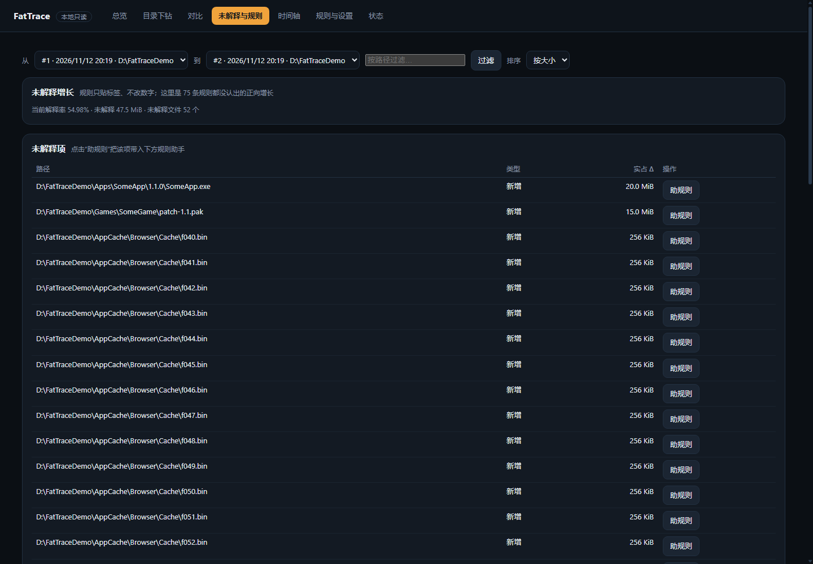

<p align="center">
  
</p>

<h1 align="center">FatTrace</h1>

<p align="center">
  <a href="https://github.com/Xeayy/FatTrace/actions/workflows/ci.yml"></a>
  <a href="LICENSE"></a>
  <a href="https://github.com/Xeayy/FatTrace/releases/latest"></a>
</p>

<p align="center">
  Windows 本地磁盘增长追踪器：每天拍快照、每周做对比，回答三个问题——<b>哪里在长、长了多少、可能是什么</b>。<br>
  只观察、只解释，<b>不删除、不移动、不清理</b>你的任何文件。
</p>

---

## 它做什么

- **每日快照 + 每周全量对比**：用 NTFS FileID 对齐文件/目录，识别新增、变大、变小、删除、move/rename，并做目录归因。
- **规则解释增长**：75 条内置规则把增长归类为缓存、日志、应用更新、游戏安装、开发产物等；支持用户 `rules.yaml` 扩展。
- **多种查看方式**：单文件离线 HTML 周报、只读本地网页（treemap / 下钻 / 对比 / 时间轴）、系统托盘、命令行。
- **未解释项浏览器 + 规则助手**：浏览没被规则认出的增长，预览候选规则命中，生成 `rules.yaml` 草稿（需你确认才生效）。
- **采集健康告警**：扫描失败、连续失败、数据过期会在 doctor / 托盘 / 网页统一提示。
- **无人值守**：Windows 计划任务每日/每周自动采集，错过补跑，可仅交流电运行。

## 截图

| 对比与 treemap | 未解释项浏览器 |
|---|---|
|  |  |

| 规则与设置 | 状态与健康 |
|---|---|
|  |  |

> 截图来自中性演示数据（`D:\FatTraceDemo`），非真实用户文件。

## 一分钟上手

1. 从 [Releases](https://github.com/Xeayy/FatTrace/releases/latest) 下载 `fat-<版本>-windows-amd64.exe` 与 `fatgui-<版本>-windows-amd64.exe`，**放在同一目录**（可重命名为 `fat.exe` / `fatgui.exe`）。
2. 双击 `fatgui.exe`：无控制台闪窗，启动托盘并打开本地面板。
3. 首次按提示设置扫描根（如 `D:\`）；之后可安装计划任务自动采集。

命令行等价流程：

```powershell
.\fat.exe setup -roots "D:\"     # 初始化数据库/配置，检查计划任务
.\fat.exe maintain --kind daily  # 采集一次快照 + 日汇总 + 告警
.\fat.exe tray                   # 托盘 + 只读网页（或双击 fatgui.exe）
.\fat.exe report --week          # 生成单文件 HTML 周报
```

> 无安装器、无代码签名：首次运行可能触发 SmartScreen，选择“仍要运行”即可。无需管理员权限。

## 隐私与安全

- **完全本地**：仅监听 `127.0.0.1` 随机端口 + 每会话 token；无网络请求、无遥测、无云同步。
- **只读**：网页与报告不提供任何写/删除接口；清理只发生在 FatTrace 自己的历史数据库（`fat prune`），**永不触碰被扫描文件**。
- 数据库/报告/日志含**完整文件路径与大小**，属本地敏感数据；对外分享前请自行检查。详见 [SECURITY.md](SECURITY.md)。

## 已知限制

- 仅支持本地 **NTFS**（Windows 10/11）；跳过 junction/symlink、网络路径。
- 标准用户无法读取受保护目录（如 `System Volume Information`），覆盖率通常 ~99%；卷级差额会归因区分“不可见系统区域”与“文件统计遗漏”。
- 非实时监控；按计划给出增长线索。
- 不提供自动清理；不是杀毒/勒索防护工具。

## 工作原理

1. **快照**：`NtQueryDirectoryFile` + FileID 枚举元数据（路径/大小/实占/时间戳），硬链接去重、跳过 junction；写入 SQLite（WAL）。
2. **对比**：按 FileID 对齐两次快照，分类新增/变大/变小/删除/move/rename，做 move-adjusted 目录归因。
3. **解释**：规则引擎给正向增长贴类别标签，算解释率；未解释项可浏览并半自动补规则。
4. **校验**：根目录 Δ 与卷用量 Δ 交叉校验；差额归因区分“扫描不可见系统区域”与“文件统计遗漏”。
5. **展示**：CLI / 单文件 HTML 周报 / 只读本地 Web / 托盘，全部同源数据。

## 常用命令

| 命令 | 作用 |
|---|---|
| `fat setup` | 首次配置：建库/配置/检查计划任务 |
| `fat snap <root>` | 采集一次快照 |
| `fat maintain --kind daily\|weekly` | 快照+日汇总+告警+(周报/清理) |
| `fat diff [--from A --to B]` | 对比两次快照 |
| `fat report [--week]` | 生成单文件 HTML 周报 |
| `fat serve [--open]` / `fat tray` / `fatgui.exe` | 只读网页 / 托盘 / 无闪窗启动 |
| `fat daily` / `fat alerts` | 日汇总 / 增长告警 |
| `fat prune [--apply]` | 清理 FatTrace 自身过期历史（默认 dry-run） |
| `fat schedule install\|status\|uninstall` | 计划任务管理 |
| `fat doctor` / `fat status` | 自检 / 概况 |

完整参数见 `fat help`。

## 排障与 FAQ

- **首次运行被 SmartScreen 拦**：无签名所致，选“仍要运行”；或自行签名。
- **diff/报告说没有可比对象**：只有一份快照；等第二次采集后再看。
- **覆盖率 <100%**：标准用户读不到受保护目录，属预期；看错误计数与卷级归因。
- **卷级校验 WARN**：看“差额中未解释”；接近 0 表示差额来自不可见系统区域，通常无需排查。
- **报告提示 file rows pruned**：文件明细按保留策略清理，目录聚合仍可浏览。
- **改了 rules.yaml 不生效**：规则在进程启动时加载，重启 `serve`/`tray`。
- **想要演示/截图数据**：`python scripts/demo_data.py init` → 快照 → `grow` → 再快照（中性数据，见 [scripts/demo_data.py](scripts/demo_data.py)）。
- 更多：`fat doctor` 会给出可执行 hint；文档索引见 [docs/README.md](docs/README.md)。

## 配置

配置在数据库同目录 `config.yaml`（`fat config init` 生成）；用户规则见 [examples/rules.yaml](examples/rules.yaml)。常用项：

| 键 | 说明 |
|---|---|
| `schedule.roots` | 扫描根列表 |
| `schedule.daily_at` / `weekly_at` | 每日/每周采集时间 |
| `schedule.ac_only` | 仅交流电启动计划扫描（默认 true） |
| `retention.*` | 快照/文件行/汇总保留期（只清 FatTrace 自身历史） |
| `alerts.growth_bytes` / `growth_pct` / `growth_multiple` | 增长告警阈值 |
| `alerts.stale_hours` | 数据过期阈值（默认 36h） |

## 从源码构建

```powershell
git clone https://github.com/Xeayy/FatTrace.git
cd FatTrace
go build -trimpath -ldflags "-s -w -X main.version=1.3.1" -o fat.exe .\cmd\fat
go build -trimpath -ldflags "-s -w -H windowsgui -X main.version=1.3.1" -o fatgui.exe .\cmd\fatgui
go vet ./...
go test ./... -count=1
```

需要 Go 1.27+。发布双架构产物见 `scripts/release.ps1`。贡献指南见 [CONTRIBUTING.md](CONTRIBUTING.md)。

## 许可

[MIT](LICENSE) © Xeayy
